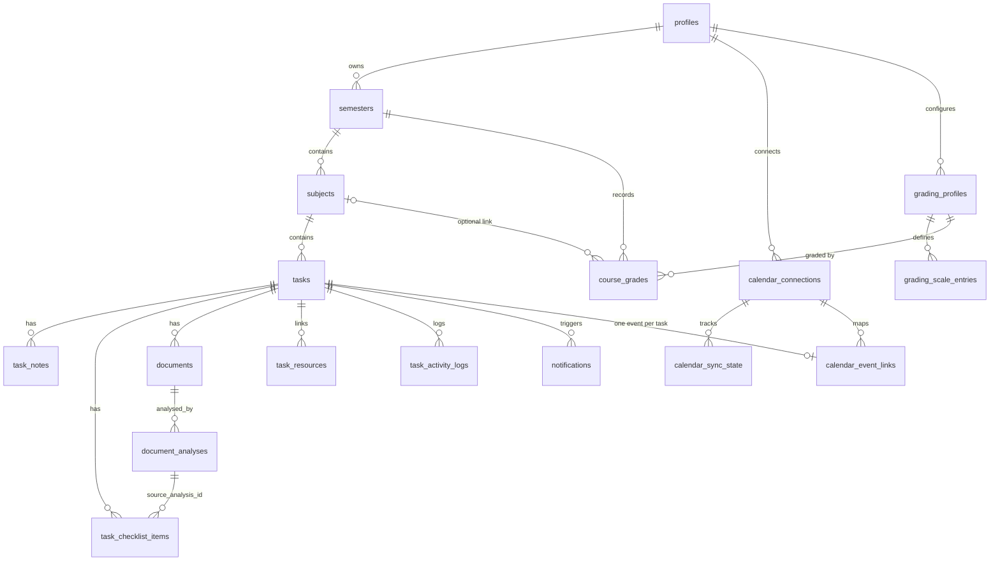

# University Assignment Manager: architecture plan (Phase 0)

Status as of 2026-10-19. Phase 0 and Phase 1 are done. Later phases are planned below, not built.

## 1. Repository state at start

The folder was empty, so there was no existing code to inspect or preserve. The project was created with `create-next-app@16.4.2` (npm, App Router, TypeScript strict, Tailwind v4, ESLint), then shadcn/ui (Radix base) was added.

## 2. Stack and versions

| Area | Choice | Version |
|---|---|---|
| Runtime | Node.js | 24.20 |
| Framework | Next.js App Router, Turbopack, Cache Components | 16.4.2 |
| UI | React | 19.3 |
| Styling | Tailwind CSS | 4.x |
| Components | shadcn/ui (Radix), lucide-react icons | radix-ui 1.8, lucide 1.59 |
| i18n | next-intl, routes `/en/...` and `/zh-CN/...` | 4.14.9 |
| Tests | Vitest | 5.0.5 |
| Database, auth, storage | Supabase (Postgres, Auth, RLS, Storage) | Phase 3 |
| Validation | zod | Phase 3 |
| Hosting | Vercel + GitHub | Phase 11 |

Next.js 16 differences that affect this code: `middleware.ts` is now `src/proxy.ts`; `params` and `searchParams` are promises and must be awaited; with Cache Components, anything that reads request data or the current time must be inside `<Suspense>`, cached, or rendered on the client.

## 3. Logical architecture

```
Browser (React client components: forms, calendar, language switcher)
   │
   ▼
Next.js on Vercel
   ├─ src/proxy.ts            locale routing now; session refresh + route protection in Phase 3
   ├─ src/app/[locale]/(app)  pages (server components) — presentation only
   ├─ src/server/actions/     Server Actions: validate (zod) → authorize → call services   [Phase 3+]
   ├─ src/server/services/    business logic: semesters, tasks, GPA engine, sync, notifications
   ├─ src/server/data/        data access through the Supabase server client (RLS applies)
   ├─ src/server/integrations/ Google Calendar, AI provider, document extraction
   └─ src/app/api/cron/...    scheduled jobs (reminders, calendar pull), protected by CRON_SECRET
   │
   ▼
Supabase: Postgres + RLS · Auth · private Storage bucket "documents"
External: Google OAuth + Calendar API · AI provider API
```

Rules:
- Pages and components never talk to the database directly; they call server actions or services.
- The GPA/CGPA engine (`src/lib/grading/`) is pure TypeScript with no I/O, so it can be unit-tested against the transcript fixture.
- The service-role key is used only in cron jobs and admin tasks, never in user-facing requests. User requests use the user's session so RLS is enforced.
- Uploaded documents and AI output are treated as untrusted data.

## 4. Database relationships

Every user-owned table has `user_id uuid not null references auth.users`, RLS enabled, and policies of the form `user_id = auth.uid()`. Composite foreign keys `(id, user_id)` make the database reject cross-user links. For example, a task can only reference a subject with the same `user_id`.



Key constraints planned for the Phase 3 migrations:
- `calendar_event_links`: unique `(connection_id, task_id)` and unique `(calendar_id, google_event_id)`, so events are never duplicated.
- `notifications`: unique `(user_id, task_id, notification_type, scheduled_for)`, so the same reminder is never created twice.
- `documents`: unique `(task_id, filename, version)`; a new upload of the same brief creates version n+1 and keeps the old one.
- `course_grades.grade_point`, `marks` and `credit_hours` are `numeric`. A missing mark is `NULL`, never `0`.
- Deletes: archiving sets `semesters.status = 'archived'` and `archived_at`, and nothing cascades. Hard deletes use `ON DELETE RESTRICT` from semesters downward, so academic history cannot be removed by accident.
- `profiles.preferred_locale` is checked against `('en','zh-CN')`, and `profiles.time_zone` defaults to `Asia/Kuala_Lumpur`.

## 5. Project structure

```
messages/en.json, zh-CN.json        all interface text (tested for matching keys)
src/proxy.ts                        locale routing (later: auth session refresh)
src/i18n/                           routing, request config, navigation helpers, client provider
src/app/[locale]/layout.tsx         <html>, fonts, intl provider
src/app/[locale]/(app)/layout.tsx   sidebar + top bar shell
src/app/[locale]/(app)/<section>/   dashboard, semesters, subjects, tasks, calendar, grades, archive, notifications, settings
src/components/layout/              brand, sidebar nav, mobile nav, top bar, language switcher
src/components/ui/                  shadcn/ui primitives
src/lib/                            shared utilities (grading engine arrives in Phase 7)
tests/                              Vitest unit tests
docs/                               this plan, later: backup and recovery, deployment
```

## 6. Environment variables

See `.env.example`. Only `NEXT_PUBLIC_*` values reach the browser. `.env*` files are git-ignored, except `.env.example`.

## 7. External accounts you will need

| Service | When | What to set up |
|---|---|---|
| GitHub | before deploy | a private repository for this folder |
| Supabase | Phase 3 | a project (Singapore region is closest to Malaysia); copy the URL and anon key; later run the migrations; create a private bucket `documents` |
| Google Cloud | Phase 9 (and optional Google sign-in in Phase 3) | a project; enable the Google Calendar API; an OAuth consent screen; a Web OAuth client with redirect URIs for localhost and the Vercel domain |
| AI provider | Phase 8 | an API key and a model name |
| Vercel | Phase 11 | import the GitHub repo, add the environment variables, add Cron Jobs for reminders |

## 8. Implementation checklist

- [x] Phase 0: inspect the folder, plan the architecture, relationships, environment and accounts
- [x] Phase 1: Next.js 16 + TS strict + Tailwind 4 + shadcn/ui; design tokens from the approved design; responsive shell (sidebar, top bar, mobile sheet menu); all nine nav sections; ESLint; Vitest; production build passes
- [~] Phase 2: done — `/en` and `/zh-CN` routes, complete catalogs for the current UI, header and Settings switcher that keeps the current page, key-parity tests, preference saved to `profiles.preferred_locale` and applied at sign-in. Remaining — locale-aware date and number helpers for deadlines
- [~] Phase 3: done — migrations for all 17 tables with composite-FK ownership, RLS, column-level token protection, private storage bucket; 29 database tests in PGlite, including two-user isolation; Supabase SSR clients; proxy session refresh and route protection; sign up, email confirmation, login, logout, password reset, optional Google; profile and language saved to the account. Remaining — run `db push` against your project, test sign-up end to end with real email, generate `database.types.ts` (`npm run db:types`)
- [ ] Phase 4: semesters and subjects CRUD, archive/restore, search
- [ ] Phase 5: tasks, notes, checklists, document upload, resource links, activity log
- [ ] Phase 6: internal calendar, deadline indicators, notifications + scheduled job
- [ ] Phase 7: grading profiles, APU scale, GPA/CGPA engine, transcript regression tests, goal calculator
- [ ] Phase 8: PDF/DOCX extraction, OCR fallback, structured AI analysis, review and edit
- [ ] Phase 9: Google OAuth, two-way Calendar sync, conflicts, retries
- [ ] Phase 10: dashboard metrics from real data, global search, archive views
- [ ] Phase 11: E2E tests, deployment, HTTPS checks, backup and recovery docs

## 9. Known decisions and open points

- Default time zone is `Asia/Kuala_Lumpur` until each user's zone is stored. Deadlines are stored as `timestamptz`.
- The transcript fixture cross-check found a rounding detail to verify in Phase 7. Semester 1 shows 3.68, but a cumulative 3.71 after semester 2 is only consistent if the unrounded semester 1 GPA is about 3.675. The engine must use unrounded values, and the test will confirm this from the module-level data.
- Treatment of CT (credit transfer) and a mark of 0 remain "pending confirmation", as the brief requires.
